 

🧰 USADO NOS PROJETOS

  

## 🚀 Projetos

  

## 👾 Atividade

<picture>
  <source media="(prefers-color-scheme: dark)" srcset="https://raw.githubusercontent.com/ribeirou/ribeirou/output/pacman-contribution-graph-dark.svg" />
  <source media="(prefers-color-scheme: light)" srcset="https://raw.githubusercontent.com/ribeirou/ribeirou/output/pacman-contribution-graph.svg" />
  
</picture>

  

